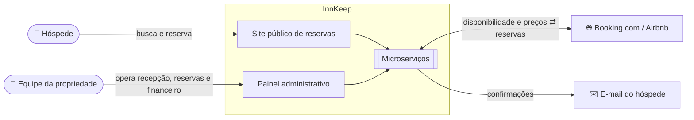
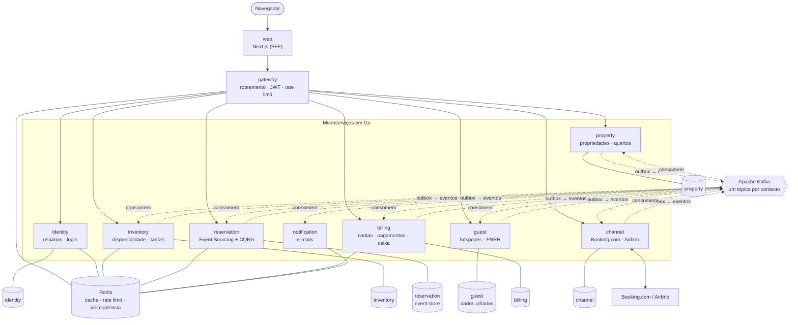
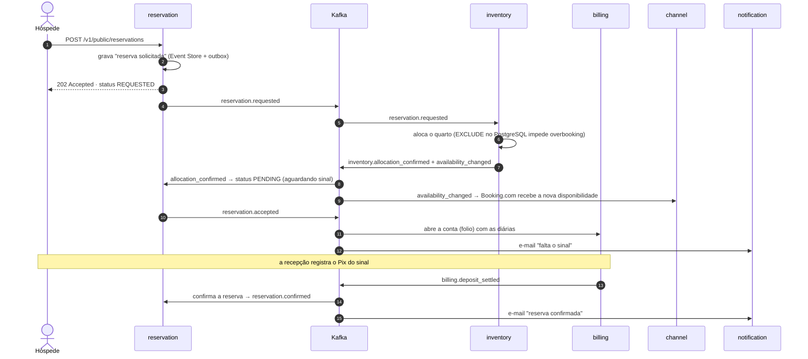
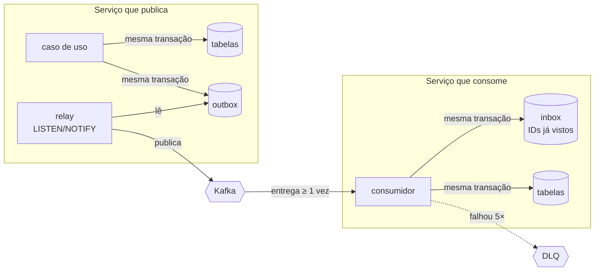
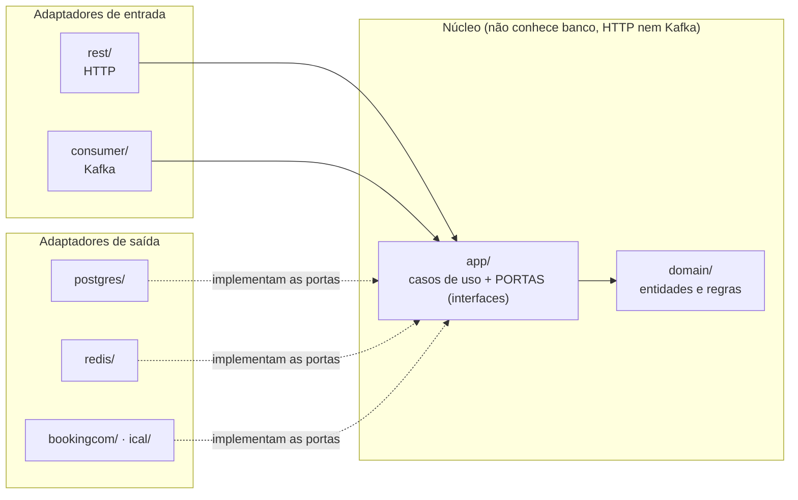
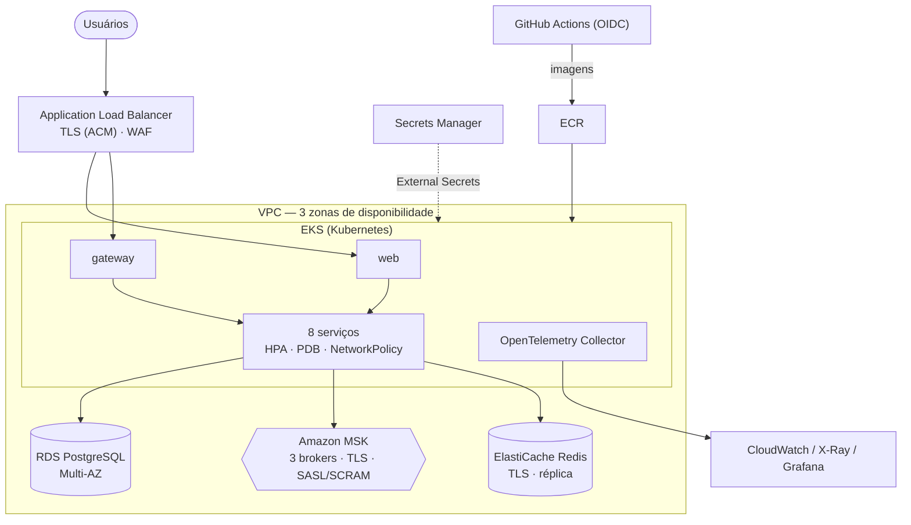

<div align="center">

# InnKeep

**Sistema de gestão hoteleira (PMS) de código aberto para hotéis, pousadas e hostels.**

Reservas, disponibilidade, check-in com a ficha exigida por lei (FNRH), financeiro completo
e sincronização com Booking.com e Airbnb — em uma arquitetura de microserviços orientada a eventos.

`Go` · `Next.js` · `PostgreSQL` · `Apache Kafka` · `Redis` · `OpenTelemetry` · `Docker` · `Kubernetes` · `AWS`

[](https://github.com/davidrodma/innkeep/actions/workflows/ci.yml)
[](LICENSE)

</div>

---

## Sumário

- [O que o InnKeep faz](#o-que-o-innkeep-faz)
- [Comece em 5 minutos](#comece-em-5-minutos)
- [Arquitetura em diagramas](#arquitetura-em-diagramas)
- [Estrutura do repositório](#estrutura-do-repositório)
- [Testes](#testes)
- [Documentação](#documentação)
- [Segurança e LGPD](#segurança-e-lgpd)
- [Como contribuir](#como-contribuir)

## O que o InnKeep faz

| Área | Funcionalidades |
|---|---|
| **Reservas** | Calendário de ocupação (tape chart), reservas diretas e pelo site, sinal com prazo de pagamento, confirmação automática ao receber o sinal, alteração de datas/quarto, cancelamento, no-show, histórico completo de cada reserva. |
| **Disponibilidade e tarifas** | Diária por tipo de acomodação e por data (alta temporada, fim de semana), estadia mínima, fechamento de vendas (stop-sell), bloqueio de quartos para manutenção. Overbooking impossível por construção. |
| **Recepção** | Ficha Nacional de Registro de Hóspedes (FNRH) com validação de CPF e regra de menores desacompanhados (ECA), check-in, check-out (inclusive antecipado), governança (quarto limpo/sujo). |
| **Financeiro** | Conta do hóspede (folio) com diárias e extras; **pagamentos parciais e com várias formas misturadas** (Pix + dinheiro + cartão); taxas por forma de pagamento (maquininha, comissão do Booking.com); despesas; caixa em espécie (sangria/suprimento); contas a receber; relatório mensal com ocupação, ADR e RevPAR. |
| **Canais de venda** | Booking.com pela API de conectividade (para parceiros certificados) ou por calendário iCal; Airbnb por iCal. Toda mudança de disponibilidade é replicada automaticamente. Simulador de OTA incluso para desenvolver sem credenciais. |
| **Site público** | Busca de disponibilidade, reserva online e página de acompanhamento com instruções de Pix. E-mails transacionais. |
| **Equipe** | Usuários com papéis (administrador, gerente, recepção, financeiro, governança) e restrição por propriedade. Várias propriedades na mesma instalação. |

## Comece em 5 minutos

Você só precisa do **Docker** (com Docker Compose). Não é preciso instalar Go nem Node.

```bash
git clone https://github.com/davidrodma/innkeep.git
cd innkeep
cp .env.example .env
docker compose up -d --build        # sobe os 9 serviços, a infraestrutura e o site
docker compose run --rm seed        # carrega uma pousada de demonstração
```

| Endereço | O que é |
|---|---|
| http://localhost:3000 | Site de reservas e painel (`/login` → `admin@innkeep.local` / `innkeep-dev-admin`) |
| http://localhost:8080 | API (gateway) |
| http://localhost:8025 | E-mails enviados pelo sistema (Mailpit) |
| http://localhost:8085 | Tópicos e mensagens do Kafka (Kafka UI) |
| http://localhost:8090 | Simulador de OTA (faz o papel da Booking.com) |

O passo a passo completo — inclusive com traces no Jaeger e métricas no Grafana — está em
[docs/guides/deploy-local.md](docs/guides/deploy-local.md). Para colocar em produção na AWS, veja
[docs/guides/deploy-producao.md](docs/guides/deploy-producao.md).

## Arquitetura em diagramas

> A explicação completa — **por que** cada decisão foi tomada, com analogias para quem está
> chegando agora em microserviços, Go, Kafka e Redis — está em
> [docs/architecture/overview.md](docs/architecture/overview.md). As decisões formais ficam nos
> [ADRs](docs/adr/).

### 1. Contexto: quem usa o sistema



### 2. Contêineres: os serviços e o que cada um guarda

Cada serviço é dono do **seu** banco. Ninguém lê o banco de outro: eles conversam por eventos no Kafka.



### 3. A saga de uma reserva feita pelo site

Uma reserva atravessa quatro serviços sem que nenhum chame o outro diretamente. Cada passo é uma
transação local que publica um fato; o próximo serviço reage a ele (**saga coreografada**).



Se o inventário não tiver quarto, ele publica `allocation_rejected` e a reserva vira `REJECTED`.
Se o sinal não for pago no prazo, a reserva expira, o quarto é liberado e a disponibilidade volta
aos canais — tudo por eventos.

### 4. Como um evento nunca se perde (Outbox) nem é processado duas vezes (Inbox)



### 5. Por dentro de um serviço: arquitetura hexagonal



### 6. Produção na AWS



## Estrutura do repositório

```text
.
├── pkg/                        # código compartilhado entre os serviços
│   ├── kernel/                 # Shared Kernel (DDD): Money, Date, StayPeriod, erros, IDs, papéis
│   ├── contracts/              # eventos de integração (CloudEvents) — o "idioma" entre serviços
│   └── platform/               # kit técnico: postgres, outbox, inbox, eventstore, messaging,
│                               # httpx, auth, redisx, telemetry, fieldcrypt, app
├── services/                   # um microserviço por pasta, todos com o mesmo formato:
│   └── <serviço>/
│       ├── cmd/<serviço>/      #   main.go — raiz de composição (liga as peças)
│       ├── internal/domain/    #   entidades e regras de negócio
│       ├── internal/app/       #   casos de uso e portas (interfaces)
│       ├── internal/adapter/   #   in/ (rest, consumer) e out/ (postgres, redis, ...)
│       └── migrations/         #   SQL versionado, embutido no binário
├── web/                        # Next.js: site público (/p/...) e painel (/admin/...)
├── tools/otasim/               # simulador da Booking.com/Airbnb para desenvolvimento
├── tools/seed/                 # dados de demonstração (pela API, como um cliente real)
├── tests/e2e/                  # testes de ponta a ponta da API
├── deploy/
│   ├── docker/                 # Dockerfile dos serviços, scripts e configs locais
│   ├── helm/innkeep/           # chart do Kubernetes
│   └── terraform/              # infraestrutura AWS (VPC, EKS, RDS, MSK, ElastiCache, ECR, IAM)
├── docs/                       # arquitetura, ADRs, guias, API, glossário
└── .claude/                    # regras, skills e agentes para desenvolvimento com IA
```

## Testes

| Camada | Ferramenta | Como rodar |
|---|---|---|
| Unitários do domínio (Go) | `go test` | `./scripts/go-docker.sh go test ./...` |
| Integração com PostgreSQL real | `go test -tags=integration` | veja [deploy-local.md](docs/guides/deploy-local.md#testes) |
| Ponta a ponta da API (stack completa) | `go test -tags=e2e` | `go test -tags=e2e ./tests/e2e/...` |
| Unitários do front-end | Vitest + Testing Library | `cd web && npm test` |
| Ponta a ponta no navegador | Playwright | `cd web && npm run test:e2e` |

Alguns destaques do que é provado automaticamente:

- **20 gravações simultâneas** do mesmo quarto nas mesmas datas → exatamente 1 vence (restrição `EXCLUDE` do banco);
- dois comandos concorrentes sobre a mesma reserva → o segundo recebe conflito (concorrência otimista do Event Store);
- transação desfeita depois de publicar → o evento some junto (Transactional Outbox);
- reserva feita no simulador do Booking.com → entra no InnKeep; cancelada lá → cancelada aqui e o quarto volta à venda;
- reserva pelo site → recepção recebe o sinal em Pix + dinheiro → reserva confirmada (no navegador, com Playwright).

## Documentação

| Documento | Para quê |
|---|---|
| [Arquitetura explicada](docs/architecture/overview.md) | O porquê de cada decisão, em linguagem didática |
| [Decisões de arquitetura (ADRs)](docs/adr/) | Registro formal das escolhas e alternativas descartadas |
| [Eventos](docs/architecture/events.md) | Catálogo de eventos, tópicos e quem consome o quê |
| [Referência da API](docs/api.md) | Todos os endpoints, gerada a partir do código |
| [Deploy local](docs/guides/deploy-local.md) | Rodar, depurar e testar na sua máquina |
| [Deploy em produção](docs/guides/deploy-producao.md) | AWS passo a passo: Terraform, EKS, segredos, CI/CD |
| [Glossário](docs/glossary.md) | Termos de hotelaria e de arquitetura |

## Segurança e LGPD

O código é público, então a segurança não pode depender de segredo de implementação. Resumo do que
foi feito (detalhes em [SECURITY.md](SECURITY.md)):

- senhas com **Argon2id**; JWT assinado com **Ed25519**, validado por chave pública (JWKS) em cada serviço;
  refresh token com rotação e detecção de reuso; bloqueio após tentativas de login;
- **documentos dos hóspedes e credenciais dos canais cifrados** (AES-256-GCM) na aplicação, com índice cego para busca;
- eventos nunca carregam dados pessoais sensíveis; logs registram IDs, não nomes ou e-mails;
- proteção contra SSRF nas URLs informadas por usuários, SQL sempre parametrizado, CORS restrito,
  cabeçalhos de segurança, limites de requisição, contêineres sem root e com sistema de arquivos somente leitura;
- nenhum segredo no repositório: tudo por variáveis de ambiente / AWS Secrets Manager.

## Como contribuir

Leia o [CONTRIBUTING.md](CONTRIBUTING.md). Em resumo: código em inglês, comentários e documentação em
português, testes acompanhando cada mudança e o CI verde antes do merge.

## Licença

[MIT](LICENSE).
