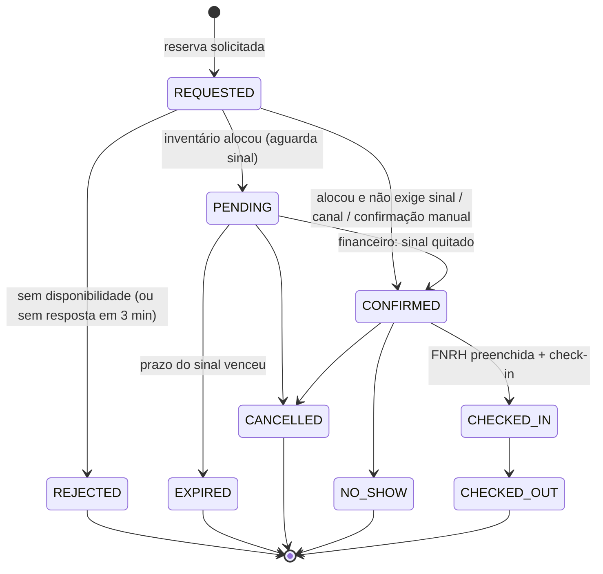
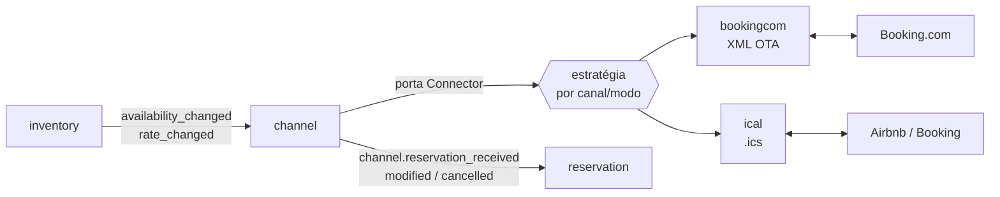

# Arquitetura do InnKeep, explicada

Este documento conta **como** o InnKeep foi construído e, principalmente, **por que** cada escolha foi
feita. Ele foi escrito para quem já programa há anos, mas ainda não trabalhou com microserviços, Go,
Kafka ou Redis. Cada conceito aparece no momento em que é necessário, com um ponteiro para o código
onde ele está implementado.

> Atalhos: [Da planilha ao sistema](#1-da-planilha-ao-sistema) · [Por que microserviços](#2-por-que-microserviços-e-onde-cortar) ·
> [Kafka](#4-kafka-para-quem-nunca-usou) · [Outbox/Inbox](#5-outbox-e-inbox-o-problema-da-escrita-dupla) ·
> [Sagas](#6-sagas-transações-que-atravessam-serviços) · [Event Sourcing](#7-event-sourcing-e-cqrs-no-serviço-de-reservas) ·
> [Hexagonal](#8-dentro-de-um-serviço-hexagonal-clean-architecture-solid-e-ddd) · [Overbooking](#9-overbooking-impossível-por-construção) ·
> [Redis](#10-redis-cinco-usos-uma-regra) · [Canais](#11-booking-com-e-airbnb) · [Segurança](#12-segurança) ·
> [Observabilidade](#13-observabilidade) · [Front-end](#14-front-end) · [Go para quem vem do TypeScript](#15-go-para-quem-vem-do-typescript) ·
> [Padrões](#16-padrões-de-projeto-e-onde-encontrá-los) · [Limites](#17-limites-conhecidos-e-próximos-passos)

---

## 1. Da planilha ao sistema

A planilha financeira usada hoje foi o ponto de partida para entender **o que** a operação precisa
registrar. O desenho do sistema, porém, segue os PMS (Property Management Systems) consolidados do
mercado — Cloudbeds, Mews, Opera, Little Hotelier e os nacionais — e não a estrutura da planilha.

| Na planilha | No InnKeep | O que muda |
|---|---|---|
| Uma aba por mês com check-in, check-out, nome, quarto, hóspedes | **Reservas** com ciclo de vida (solicitada → pendente → confirmada → hospedada → finalizada) | O sistema impede datas inválidas — a planilha tinha estadias de −30 e de 3.655 noites, digitadas por engano. |
| "Valor" + "Adicional" | **Conta do hóspede (folio)**: uma diária por noite + consumos/extras | Cada lançamento é imutável; um erro é corrigido por anulação, que fica registrada. |
| "Forma de Pagamento" como texto livre (`Pix 400 + Pix 460`, `Booking + Pix`) | **Pagamentos estruturados**, vários por lançamento, cada um com forma e valor | Dá para somar por forma de pagamento, conciliar e saber exatamente quanto falta. |
| "% Booking/Cartão" e "Líquido" | **Taxas por forma de pagamento** (ex.: Booking 15%, crédito 6%) calculadas a cada recebimento | O valor líquido sai automaticamente no relatório, por forma e por canal. |
| "(devendo R$ 70)" escrito no meio do texto | **Saldo da conta** e tela de **contas a receber** | O saldo é calculado; ninguém precisa lembrar de quem está devendo. |
| Bloco de despesas com "Situação: Pago / À pagar" | **Despesas** com categoria, vencimento e pagamento | Despesas vencidas aparecem destacadas; pagamentos em dinheiro saem do caixa sozinhos. |
| "Caixa em espécie": inicial, do mês, sacado, atual | **Caixa** com entradas e saídas (sangria/suprimento) e motivo | Recebimentos e despesas em dinheiro movimentam o caixa automaticamente. |
| Aba "Diário": grade quarto × dia | **Calendário de ocupação** e **grade de tarifas** | Clicar em um dia livre já abre uma reserva para aquele quarto e data. |
| "Ocupação" calculada à mão | **Ocupação, ADR e RevPAR** no relatório mensal | Indicadores padrão da hotelaria, comparáveis entre meses. |
| Reservas do Booking digitadas à mão | **Integração com Booking.com e Airbnb** | A reserva entra sozinha; a disponibilidade sai sozinha. |
| — | **FNRH**, governança, usuários com papéis, site de reservas, e-mails | O que a planilha não tinha e um hotel precisa. |

> A divisão do resultado entre sócios, presente na planilha, é específica do negócio e não foi
> implementada: o "Resultado do mês" do relatório é a base para esse cálculo.

---

## 2. Por que microserviços (e onde cortar)

### O que é um microserviço

Um programa independente, com **o seu próprio banco de dados**, que cuida de **uma parte do negócio**
e conversa com os outros por rede. A palavra que importa é *independente*: cada um pode ser
implantado, escalado e até reescrito sem mexer nos demais.

O custo é real: em vez de uma chamada de função, há rede (que falha), dados espalhados (que ficam
temporariamente desencontrados) e mais peças para operar. Por isso o lugar onde se corta é a decisão
mais importante — cortar errado gera serviços que vivem conversando entre si (um "monólito distribuído").

### Onde cortar: bounded contexts (DDD)

O Domain-Driven Design ensina a cortar pelos **contextos delimitados** (*bounded contexts*): áreas
do negócio onde as palavras têm um significado próprio. "Quarto", para a governança, é um lugar a
limpar; para o inventário, é uma unidade vendável; para o financeiro, quase não existe — o que existe
é a conta. Cada contexto virou um serviço:

| Serviço | Responde à pergunta | Dono de |
|---|---|---|
| `identity` | Quem é você e o que pode fazer? | usuários, sessões, chaves JWT |
| `property` | O que a propriedade **tem**? | propriedades, tipos de acomodação, quartos, políticas |
| `inventory` | O que está **livre** e quanto **custa**? | alocações, tarifas por data, bloqueios |
| `reservation` | Qual a **história** desta reserva? | o ciclo de vida das reservas (Event Sourcing) |
| `guest` | **Quem** está hospedado? | hóspedes, FNRH — os dados pessoais |
| `billing` | Quanto **entrou e saiu**? | contas, pagamentos, despesas, caixa |
| `channel` | O que os **canais externos** sabem? | conexões, mapeamentos, sincronização |
| `notification` | Quem precisa **ser avisado**? | (nada — só reage a eventos) |
| `gateway` | Por onde se **entra**? | (nada — políticas de borda) |

Um teste prático de que o corte está bom: **o check-in não chama nenhum serviço por HTTP.** O serviço
de reservas já sabe se a FNRH foi preenchida porque o serviço de hóspedes publicou um evento quando
isso aconteceu. Se o serviço de hóspedes estiver fora do ar, o check-in continua funcionando.

### Por que não um monólito?

Para uma pousada de quatro quartos, um monólito bem organizado seria suficiente — isso precisa ser
dito com honestidade. Os microserviços aqui se justificam pelos requisitos do projeto: integração com
canais externos que falham e precisam ser isolados, o desejo de escalar (várias propriedades, um SaaS
no futuro) e, explicitamente, o objetivo de ser uma referência de arquitetura orientada a eventos.
Todos os serviços vivem em **um único repositório e um único módulo Go** — o que simplifica muito a
vida (veja o [ADR 0002](../adr/0002-monorepo-modulo-unico.md)).

---

## 3. Comunicação: quando é síncrona, quando é por eventos

Há dois jeitos de serviços conversarem:

- **Síncrono (REST)**: "faça isto e me responda agora". Usado **somente na borda**: o navegador fala
  com o gateway, que repassa ao serviço dono do dado.
- **Assíncrono (eventos)**: "aconteceu isto" — e quem tiver interesse reage, quando puder. Usado
  **entre os serviços**.

Por que evitar REST entre serviços? Porque ele **acopla disponibilidade**: se A chama B e B está fora,
A também falha. Com eventos, A grava o fato e segue a vida; B processa quando voltar. Um evento é
sempre um fato no passado (`reservation.confirmed`), nunca uma ordem (`confirm-reservation`).

O preço é a **consistência eventual**: por alguns milissegundos, o serviço de reservas sabe que a
reserva foi confirmada e o financeiro ainda não. O sistema foi desenhado para conviver com isso — a
API responde `202 Accepted` ao criar uma reserva, e a tela se atualiza sozinha até a saga terminar
(componente [`AutoRefresh`](../../web/src/components/ui/auto-refresh.tsx)).

Uma técnica que reduz a necessidade de perguntar aos outros: **Event-Carried State Transfer**. Os
eventos do catálogo levam o estado completo (`RoomTypeDefined` traz nome, capacidade, preço), e o
inventário mantém uma **cópia local somente leitura**. Ele nunca consulta o serviço de propriedades.

---

## 4. Kafka para quem nunca usou

Pense no Kafka como um **livro-caixa compartilhado, em que só se escreve no fim**. Os serviços
anotam fatos; outros leem, cada um no seu ritmo, a partir de onde pararam.

| Conceito | O que é | No InnKeep |
|---|---|---|
| **Tópico** | Um livro com nome | Um por contexto: `innkeep.reservation.events`, `innkeep.inventory.events`... |
| **Partição** | O tópico é dividido em N "colunas"; a **ordem só é garantida dentro de uma partição** | 3 partições por tópico |
| **Chave** | Decide a partição (hash da chave) | O ID do agregado: todos os eventos da mesma reserva caem na mesma partição, **em ordem** |
| **Grupo consumidor** | Instâncias que dividem o trabalho; grupos diferentes recebem tudo, cada um | Cada serviço é um grupo (`billing`, `inventory`...) |
| **Offset** | "Li até aqui" | Confirmado **só depois** de processar: se o serviço cair no meio, reprocessa |
| **Retenção** | Por quanto tempo as mensagens ficam | 7 dias — um serviço novo pode reconstruir seus dados relendo o histórico |
| **DLQ** | *Dead Letter Queue*: para onde vai a mensagem que falha sempre | `innkeep.dlq.<serviço>`, com o motivo nos cabeçalhos |

Por que um tópico **por contexto** e não um por tipo de evento? Porque a ordem entre eventos
diferentes da mesma reserva importa ("confirmada" antes de "check-in"), e o Kafka só ordena dentro
da mesma partição do mesmo tópico.

Por que Kafka e não RabbitMQ ou SQS? Kafka **guarda** os eventos (replay, novos consumidores lendo o
passado), ordena por chave e escala horizontalmente — ele é um log, não uma fila. Veja o
[ADR 0003](../adr/0003-kafka-como-barramento-de-eventos.md).

O formato das mensagens segue o padrão **CloudEvents 1.0** (envelope com `id`, `type`, `source`,
`time`, `correlationid`, `traceparent`): [`pkg/contracts/envelope.go`](../../pkg/contracts/envelope.go).
O catálogo completo está em [events.md](events.md).

**Garantia de entrega**: "pelo menos uma vez". Nunca se perde, mas pode chegar repetido — daí a
próxima seção.

---

## 5. Outbox e Inbox: o problema da escrita dupla

### O problema

Ao confirmar uma reserva, o serviço precisa (1) gravar no banco **e** (2) publicar no Kafka. São dois
sistemas; não existe transação que cubra os dois. Se o processo cair entre (1) e (2), o banco diz
"confirmada" e ninguém mais fica sabendo — para sempre.

### A solução: Transactional Outbox

O evento é gravado em uma tabela `outbox` **do próprio banco, na mesma transação** da mudança. Ou as
duas coisas acontecem, ou nenhuma. Um processo separado — o **relay** — lê a tabela e publica no
Kafka, repetindo até conseguir ([`pkg/platform/outbox`](../../pkg/platform/outbox/)).

Detalhes que valem a leitura no código:

- o relay **não fica consultando a tabela a cada segundo**: ele usa `LISTEN/NOTIFY` do PostgreSQL e
  acorda no instante do commit;
- com várias réplicas do serviço, um **advisory lock** elege uma só para publicar, preservando a ordem;
- o contexto de tracing (`traceparent`) é guardado junto do evento, então o trace distribuído não se
  quebra, mesmo com a publicação acontecendo depois.

### A outra ponta: Inbox (consumidor idempotente)

Como a entrega é "pelo menos uma vez", o mesmo evento pode chegar duas vezes. Cada consumidor anota
os IDs já processados na tabela `inbox`, **na mesma transação** em que aplica os efeitos. Repetido?
Ignorado. O efeito líquido é "exatamente uma vez" ([`pkg/platform/inbox`](../../pkg/platform/inbox/inbox.go)).

Há também idempotência **por construção**: o serviço de canais envia "2 quartos livres no dia 10"
(valor absoluto, não "−1"), e reservas vindas do Booking.com recebem um **ID determinístico**
(UUID v5 do número da reserva no canal) — recebê-la duas vezes gera o mesmo ID.

---

## 6. Sagas: transações que atravessam serviços

Uma reserva envolve reservas, inventário e financeiro. Sem transação distribuída, cada serviço faz a
**sua** parte em uma transação local e anuncia o resultado. Isso é uma **saga**. A do InnKeep é
**coreografada**: não existe um maestro; cada serviço sabe a que eventos reagir.



- **Compensações**: cancelada, expirada ou no-show → o inventário libera o quarto e o financeiro anula
  as diárias. Saída antecipada → o inventário devolve as noites que sobraram.
- **Timeouts**: uma tarefa periódica expira reservas sem sinal e rejeita pedidos que o inventário não
  respondeu em 3 minutos. Nenhuma reserva fica presa para sempre segurando um quarto.
- **Fatos fora de ordem**: eventos de tópicos diferentes não têm ordem garantida. Uma alocação que
  chega depois de um cancelamento simplesmente não se aplica mais (há teste para isso).

---

## 7. Event Sourcing e CQRS no serviço de reservas

### Event Sourcing

Em vez de guardar o **estado atual** (uma linha sobrescrita a cada mudança), o serviço de reservas
guarda a **sequência de fatos** que levou a ele. O estado é obtido reaplicando os eventos.

| Tabela comum | Event Store |
|---|---|
| `status = 'CONFIRMED'` | `requested` → `room_allocated` → `confirmed` |
| Perde-se o passado | Auditoria completa, imutável |
| "Quem mudou isso?" | Cada evento tem autor, horário, correlação e causa |

O agregado [`Reservation`](../../services/reservation/internal/domain/reservation.go) separa
**decidir** de **mudar**: os métodos de comando (`Confirm`, `CheckIn`...) validam as regras e
emitem eventos; o método `apply` é o único que altera o estado. O teste
`TestReplayRebuildsTheSameState` prova que reaplicar o histórico reconstrói o mesmo estado.

A **concorrência otimista** sai de graça: a restrição `UNIQUE (aggregate_id, version)` faz o segundo
de dois comandos concorrentes falhar; o comando é então repetido sobre o estado atualizado.

### CQRS

Ler eventos e reaplicá-los é ótimo para decidir, péssimo para listar "todas as reservas de novembro
com saldo em aberto". Por isso há **dois modelos**:

- **escrita** ([`app/command`](../../services/reservation/internal/app/command/)): agregado + Event Store;
- **leitura** ([`app/query`](../../services/reservation/internal/app/query/service.go)): a tabela
  `reservation_views`, desnormalizada e indexada para as telas.

A projeção é atualizada **na mesma transação** que grava os eventos — então nunca diverge. E ela é
descartável: `reservation rebuild-views` apaga a tabela e a reconstrói a partir dos eventos.

### Por que só neste serviço?

Event Sourcing traz conceitos, código e cuidados extras (eventos são contratos eternos). Ele vale onde
**o histórico é o próprio negócio** — e o ciclo de vida de uma reserva é exatamente isso. Nos demais
serviços, um CRUD bem feito é mais simples e suficiente ([ADR 0005](../adr/0005-event-sourcing-somente-em-reservas.md)).

---

## 8. Dentro de um serviço: hexagonal, Clean Architecture, SOLID e DDD

Todos os serviços têm o mesmo formato. Aprendeu um, aprendeu todos.

```text
services/billing/
├── cmd/billing/main.go            ← raiz de composição: cria as peças e as conecta
├── internal/
│   ├── domain/                    ← o coração: Folio, Expense, regras. Só importa pkg/kernel.
│   ├── app/                       ← casos de uso + PORTAS (interfaces do que precisa do mundo)
│   └── adapter/
│       ├── in/rest/               ← HTTP → casos de uso
│       ├── in/consumer/           ← eventos do Kafka → casos de uso
│       └── out/postgres/          ← implementa as portas de repositório
└── migrations/0001_init.sql       ← esquema versionado, embutido no binário
```

- **Arquitetura hexagonal (Ports & Adapters)**: o núcleo (`domain` + `app`) não sabe que existe
  PostgreSQL, HTTP ou Kafka. Ele declara **portas** (interfaces) e os **adaptadores** as implementam.
- **Clean Architecture**: as dependências apontam **sempre para dentro**. `adapter` conhece `app`;
  `app` conhece `domain`; `domain` não conhece ninguém. O compilador garante parte disso: o que está
  em `internal/` não pode ser importado por outro serviço.
- **SOLID**: *responsabilidade única* (um handler HTTP não tem regra de negócio); *aberto/fechado*
  (um canal novo é um adaptador novo, nada mais muda); *substituição de Liskov* e *segregação de
  interfaces* (portas pequenas, como `TxRunner`); *inversão de dependência* (o caso de uso depende da
  interface `FolioRepository`, não do PostgreSQL).
- **DDD tático**: **entidades** com identidade (`Reservation`), **objetos de valor** imutáveis
  (`Money`, `StayPeriod`), **agregados** que protegem suas invariantes (`Folio` só muda por métodos que
  validam), **eventos de domínio**, **repositórios**, **Shared Kernel** ([`pkg/kernel`](../../pkg/kernel/)) e
  **Anti-Corruption Layer** (o serviço de canais traduz o XML da Booking.com para o modelo interno).

### Roteiro para ler o código pela primeira vez

1. [`pkg/kernel/money.go`](../../pkg/kernel/money.go) e [`stay.go`](../../pkg/kernel/stay.go) — dinheiro em centavos e o período de estadia semiaberto.
2. [`pkg/contracts/reservation_events.go`](../../pkg/contracts/reservation_events.go) — o idioma entre os serviços.
3. [`services/property`](../../services/property/) — o serviço mais simples: CRUD + outbox.
4. [`pkg/platform/outbox`](../../pkg/platform/outbox/) e [`messaging/consumer.go`](../../pkg/platform/messaging/consumer.go) — como os eventos saem e entram.
5. [`services/inventory/internal/app/allocation.go`](../../services/inventory/internal/app/allocation.go) — o participante da saga.
6. [`services/reservation`](../../services/reservation/) — Event Sourcing e CQRS.
7. [`tests/e2e/e2e_test.go`](../../tests/e2e/e2e_test.go) — tudo funcionando junto.

---

## 9. Overbooking impossível por construção

A pergunta "o quarto está livre?" seguida de "então reserve" tem uma falha clássica: entre as duas
etapas, outra requisição pode reservar o mesmo quarto (*race condition*). Com várias réplicas do
serviço, nem um lock em memória resolve.

A solução foi entregar a regra ao banco, que é o único ponto que enxerga todas as transações:

```sql
CONSTRAINT allocations_no_overlap EXCLUDE USING gist (
    room_id WITH =,
    (daterange(check_in, check_out, '[)')) WITH &&
) WHERE (room_id IS NOT NULL)
```

"Não podem existir duas linhas com o **mesmo quarto** (`=`) e períodos que **se sobrepõem** (`&&`)."
O intervalo `'[)'` é semiaberto: quem sai dia 12 não conflita com quem entra dia 12. O teste de
integração dispara 20 gravações simultâneas do mesmo quarto — exatamente uma vence.

A exceção controlada: reservas vindas de canais externos já estão confirmadas do lado de lá. Se não
houver quarto livre, elas entram como **overbooking** (sem quarto atribuído), a equipe é alertada no
painel e os canais passam a ver disponibilidade zero.

---

## 10. Redis: cinco usos, uma regra

O Redis é um banco **em memória**, de chave-valor, extremamente rápido e de thread única (cada
comando é atômico). No InnKeep ele **nunca** é a fonte da verdade — a regra é: *se o Redis cair, o
sistema fica mais lento ou menos protegido, mas não perde dados nem para.*

| Uso | Onde | Técnica |
|---|---|---|
| Cache da busca pública de disponibilidade | inventory | *cache-aside* com **invalidação por versão** (um contador por propriedade faz parte da chave) — invalidação **após o commit** |
| Limite de requisições | gateway | janela deslizante em **script Lua** (atômico) |
| Idempotência de POSTs | reservation, billing | `SET NX` com a `Idempotency-Key`: o clique duplo não cria duas reservas nem cobra duas vezes |
| Bloqueio de força bruta no login | identity | contador com TTL (`INCR` + `EXPIRE NX`) |
| Revogação de tokens (logout imediato) | identity → gateway | chave com TTL igual à vida restante do JWT |
| Deduplicação de e-mails | notification | `SET NX` por ID de evento |

---

## 11. Booking.com e Airbnb

### A realidade das APIs (verificada na documentação oficial)

- **Booking.com**: a *Connectivity API* (XML no padrão OTA) é aberta **somente a parceiros de
  conectividade certificados**, com conta de máquina e certificação. O adaptador implementa a
  documentação pública: autenticação por token, `OTA_HotelAvailNotif` (disponibilidade e restrições),
  `OTA_HotelRateAmountNotif` (preços), busca e confirmação de reservas novas, modificadas e canceladas.
- **Airbnb**: a API é restrita a parceiros de software homologados — não há como integrar sem esse
  contrato. O caminho disponível é o **iCal**.
- **iCal** (as duas plataformas): troca de calendários `.ics`. Funciona com qualquer conta, mas é a
  plataforma que decide quando relê o calendário (de minutos a horas) — não é tempo real.

### Como foi construído



- A porta [`Connector`](../../services/channel/internal/app/ports.go) define o que um canal faz; cada
  canal é um adaptador (padrão **Strategy**). Acrescentar a Expedia é escrever mais um.
- Toda mudança de ocupação no inventário (reserva, cancelamento, bloqueio, quarto novo) publica
  `availability_changed`; o serviço de canais envia o novo número aos canais conectados.
- Reservas do canal entram como eventos neutros (**Anti-Corruption Layer**) e o serviço de reservas
  as cria com ID determinístico e preço do canal.
- **Simulador**: [`tools/otasim`](../../tools/otasim/main.go) fala o mesmo protocolo e permite
  desenvolver e testar o fluxo inteiro sem credenciais — veja a interface em http://localhost:8090.

Dois pontos não estão explícitos na documentação pública da Booking.com e foram implementados por
inferência (marcados no código): como derivar a data de saída da reserva e como distinguir
cancelamento de modificação. Valide-os durante a certificação.

---

## 12. Segurança

O código é público: a segurança não pode depender de ninguém saber como funciona.

- **Senhas**: Argon2id (parâmetros da OWASP). Mensagem de erro e tempo de resposta iguais para
  "e-mail inexistente" e "senha errada". Bloqueio após 5 falhas.
- **Tokens**: JWT de 15 minutos assinado com **Ed25519**. Só o `identity` tem a chave privada; os
  outros validam com a chave pública (JWKS) — e cada serviço valida, mesmo atrás do gateway (defesa em
  profundidade). Só `EdDSA` é aceito (fecha ataques de troca de algoritmo).
- **Sessões**: refresh token opaco, guardado como hash, **rotacionado** a cada uso; reuso indica roubo
  e derruba a família inteira de sessões.
- **Autorização**: papéis com permissões (RBAC) + restrição por propriedade, conferida **antes** de
  qualquer alteração.
- **Dados pessoais (LGPD)**: documentos cifrados com AES-256-GCM e **índice cego** (HMAC) para busca;
  eventos não carregam dados sensíveis; listagens mascaram o documento; leituras de cadastro ficam
  registradas; anonimização a pedido do titular.
- **Entradas**: SQL sempre parametrizado; corpo JSON limitado e estrito; URLs informadas por usuários
  protegidas contra **SSRF** (bloqueio de IPs internos no momento da conexão); e-mails com escape
  automático de HTML.
- **Navegador**: o token fica em cookie `httpOnly` (nenhum JavaScript da página o lê); `SameSite=Lax`
  contra CSRF; cabeçalhos de segurança; o painel nunca chama a API diretamente (BFF).
- **Infraestrutura**: contêineres sem root, sistema de arquivos somente leitura, sem capabilities;
  NetworkPolicy "negar por padrão"; segredos no AWS Secrets Manager; CI com govulncheck, npm audit,
  gitleaks e Trivy; deploy por OIDC, sem chaves de acesso guardadas.

---

## 13. Observabilidade

Com nove serviços, "o que aconteceu com a reserva IK-7F3K9Q?" precisa de resposta em segundos.

- **Traces** (OpenTelemetry): cada requisição gera um trace que atravessa HTTP → banco → outbox →
  Kafka → outro serviço. O `traceparent` viaja dentro do envelope do evento, então a saga inteira
  aparece como **uma** árvore no Jaeger.
- **Métricas**: requisições, latência, consumo do Kafka e runtime do Go, exportadas em OTLP.
- **Logs** estruturados (JSON, `log/slog`) com `trace_id` em cada linha: do log você pula para o
  trace. Logs registram IDs, nunca dados pessoais.
- Os serviços só conhecem o **OpenTelemetry Collector**; trocar Jaeger por X-Ray ou Datadog é mudar a
  configuração do Collector, sem recompilar nada.

Para ver na prática: `docker compose --profile observability up -d` (guia em [deploy-local.md](../guides/deploy-local.md#observabilidade)).

---

## 14. Front-end

- **Next.js (App Router) + TypeScript + Tailwind CSS 4.** As páginas são **Server Components**: rodam
  no servidor, buscam os dados direto da API e enviam HTML pronto.
- **BFF (Backend for Frontend)**: o navegador só fala com o servidor do Next.js; ele chama o gateway
  pela rede interna com o token do cookie `httpOnly` ([`lib/api.ts`](../../web/src/lib/api.ts)).
- **Server Actions** para todos os formulários ([`features/*/actions.ts`](../../web/src/features/)). As
  regras de validação ficam **no back-end**; o formulário apenas mostra o erro que a API devolveu,
  campo a campo.
- [`proxy.ts`](../../web/src/proxy.ts) (o antigo *middleware*) protege o `/admin` e renova o token em
  silêncio.
- Organização por **funcionalidade** (`features/reservations`, `features/finance`...), não por tipo de
  arquivo.

---

## 15. Go para quem vem do TypeScript

| Você conhece | Em Go |
|---|---|
| `import`/`export` | Pacote = pasta. Nome com **letra maiúscula** é exportado (`NewMoney`), minúscula é privado (`mustMatch`). |
| `class` | `struct` + métodos. Sem herança; composição por *embedding* (`type Config struct { config.Base }`). |
| `implements` | **Interfaces implícitas**: um tipo satisfaz a interface se tiver os métodos. Por isso as portas ficam em `app` e os adaptadores nem as importam. |
| `try/catch` | Erro é **valor de retorno**: `x, err := f(); if err != nil { return err }`. `errors.Is/As` inspecionam a cadeia (`%w`). |
| `async/await` | **Goroutines** (`go f()`) e canais. `errgroup` roda componentes em paralelo e para todos se um falhar ([`app.Run`](../../pkg/platform/app/app.go)). |
| `AbortController` | `context.Context`: carrega cancelamento, prazo e valores (transação, usuário, trace) por toda a chamada. |
| `finally` | `defer` — roda ao sair da função (`defer rows.Close()`). |
| npm | Módulos Go (`go.mod`); binário único e estático, sem `node_modules` em produção. |
| `null`/`undefined` | Valor zero (`""`, `0`, `nil`); ponteiros (`*int64`) para "opcional". |

Para rodar sem instalar o Go: `./scripts/go-docker.sh go test ./...`.

---

## 16. Padrões de projeto e onde encontrá-los

| Padrão | Onde |
|---|---|
| Repository | `internal/adapter/out/postgres/*_repository.go` |
| Unit of Work | [`postgres.TxManager`](../../pkg/platform/postgres/tx.go) (transação no `context`) |
| Transactional Outbox / Inbox | [`pkg/platform/outbox`](../../pkg/platform/outbox/), [`inbox`](../../pkg/platform/inbox/inbox.go) |
| Event Sourcing / CQRS | `services/reservation` |
| Saga coreografada | consumidores de `reservation`, `inventory`, `billing` |
| Strategy | conectores de canais ([`cmd/channel/main.go`](../../services/channel/cmd/channel/main.go)) |
| Adapter / Anti-Corruption Layer | `services/channel/internal/adapter/out/bookingcom` |
| Decorator / Chain of Responsibility | middlewares HTTP ([`httpx`](../../pkg/platform/httpx/middleware.go)) e de eventos ([`messaging.Router`](../../pkg/platform/messaging/router.go)) |
| API Gateway / BFF | `services/gateway`, `web/src/lib/api.ts` |
| Value Object | `kernel.Money`, `kernel.StayPeriod`, `kernel.Date` |
| Factory | `domain.NewFolio`, `domain.Request`, `contracts.NewEnvelope` |
| Dead Letter Queue / Retry com backoff | [`messaging.Consumer`](../../pkg/platform/messaging/consumer.go) |
| Cache-aside | [`redisx.GetOrLoad`](../../pkg/platform/redisx/cache.go) |
| Idempotency Key | [`redisx.Idempotency`](../../pkg/platform/redisx/idempotency.go) |
| Health Check (liveness/readiness) | [`httpx.Health`](../../pkg/platform/httpx/health.go) |

---

## 17. Limites conhecidos e próximos passos

Transparência sobre o que **não** está pronto:

- **Booking.com**: o adaptador segue a documentação pública, mas só a certificação com uma propriedade
  de teste valida de verdade (pontos inferidos estão marcados no código). Preços por ocupação (OBP) e
  por tempo de estadia (LOS) não foram implementados.
- **Pagamentos online**: o sinal é pago por Pix fora do sistema e registrado pela recepção. Integrar um
  gateway (Pix com QR dinâmico, cartão) é um adaptador novo no `billing`.
- **Envio da FNRH ao Ministério do Turismo**: a ficha é coletada e armazenada; o envio eletrônico
  oficial não está integrado.
- **Nota fiscal (NFS-e)**: fora do escopo.
- **Grupos**: o campo `group_code` existe na API; a tela ainda cria uma reserva por vez.
- **Event Store sem snapshots**: desnecessário com dezenas de eventos por reserva.
- **Painéis do Grafana**: o ambiente local traz as fontes de dados; os painéis ficam a criar.
