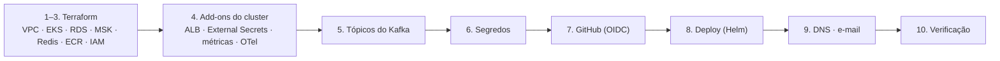

# Guia: colocando o InnKeep em produção na AWS

Este roteiro leva o InnKeep de uma conta AWS vazia até o sistema no ar, com deploy automático a cada
merge na `main`. Faça primeiro em **staging** e só depois em produção.



## Antes de começar: custos

A arquitetura de produção é robusta (três zonas de disponibilidade, Kafka com três brokers, banco
Multi-AZ). Os itens que mais pesam na conta são o **Amazon MSK** (três brokers), o **plano de controle
do EKS**, os **NAT Gateways**, o **RDS Multi-AZ** e o **ElastiCache**. Some tudo na
[calculadora da AWS](https://calculator.aws/) para a sua região antes de subir — a ordem de grandeza
é de centenas de dólares por mês.

Para uma pousada pequena, há caminhos mais baratos com o mesmo código:

- usar `environments/staging.tfvars` também em produção (máquinas menores, sem redundância);
- ou rodar o `docker-compose.yml` em **uma única VM** (EC2/Lightsail) com backups do volume do
  PostgreSQL — sem alta disponibilidade, mas com custo mínimo. Nesse caso troque as senhas do
  `.env`, defina `APP_ENV=production` e as três chaves (`JWT_PRIVATE_KEY`, `PII_ENCRYPTION_KEY`,
  `CHANNEL_ENCRYPTION_KEY`), e coloque um proxy com TLS (Caddy, Nginx) na frente das portas 3000 e 8080.

## Ferramentas

`aws` (CLI v2) · `terraform` ≥ 1.10 · `kubectl` · `helm` 3 · `jq` · `psql` · `openssl` — e uma conta
AWS com permissão de administrador para a configuração inicial.

```bash
aws configure sso            # ou outro método de login
aws sts get-caller-identity  # confirme a conta
```

## 1. Bucket do estado do Terraform (uma vez)

```bash
export AWS_REGION=sa-east-1
BUCKET=innkeep-terraform-state-$(aws sts get-caller-identity --query Account --output text)
aws s3api create-bucket --bucket "$BUCKET" --region $AWS_REGION \
  --create-bucket-configuration LocationConstraint=$AWS_REGION
aws s3api put-bucket-versioning --bucket "$BUCKET" --versioning-configuration Status=Enabled
aws s3api put-public-access-block --bucket "$BUCKET" --public-access-block-configuration \
  BlockPublicAcls=true,IgnorePublicAcls=true,BlockPublicPolicy=true,RestrictPublicBuckets=true
```

## 2. Configuração do ambiente

```bash
cd deploy/terraform
cp environments/staging.tfvars.example environments/staging.tfvars
cp environments/backend-production.hcl.example environments/backend-staging.hcl
# edite backend-staging.hcl: bucket = "<o seu>", key = "staging/terraform.tfstate"
# staging.tfvars já vem com github_repository = "davidrodma/innkeep"; num fork, troque pelo seu
```

O `github_repository` define **qual repositório** pode assumir o IAM Role de deploy via OIDC: um
token emitido para outro repositório (um fork, por exemplo) é recusado pela AWS.

## 3. Criar a infraestrutura

```bash
terraform init -backend-config=environments/backend-staging.hcl
terraform plan  -var-file=environments/staging.tfvars -out=staging.plan   # leia o plano!
terraform apply staging.plan                                               # ~25 minutos
terraform output                                                           # anote os valores
```

Isso cria: VPC em 3 zonas (sub-redes públicas, privadas e de dados), EKS com nós Graviton, RDS
PostgreSQL (TLS obrigatório, senha gerada pela AWS), MSK (TLS + SASL/SCRAM), ElastiCache Redis
(TLS + senha), repositórios ECR, o "cofre" `innkeep/<ambiente>` no Secrets Manager e o IAM Role que o
GitHub Actions assume via OIDC.

## 4. Add-ons do cluster

```bash
aws eks update-kubeconfig --name $(terraform output -raw cluster_name) --region $AWS_REGION
kubectl get nodes
```

| Add-on | Para quê | Instalação |
|---|---|---|
| **AWS Load Balancer Controller** | Cria o ALB a partir do `Ingress` | [guia oficial](https://kubernetes-sigs.github.io/aws-load-balancer-controller/) (Helm `eks/aws-load-balancer-controller`, com Pod Identity) |
| **External Secrets Operator** | Copia o segredo do Secrets Manager para um `Secret` | `helm install external-secrets external-secrets/external-secrets -n external-secrets --create-namespace` |
| **metrics-server** | Base para o autoescalonamento (HPA) | `kubectl apply -f https://github.com/kubernetes-sigs/metrics-server/releases/latest/download/components.yaml` |
| **OpenTelemetry Collector** | Recebe traces e métricas dos serviços | ADOT (add-on do EKS) ou Helm `open-telemetry/opentelemetry-collector`, no namespace `observability`, exportando para CloudWatch/X-Ray ou Grafana Cloud |

Depois do External Secrets, crie o `ClusterSecretStore` chamado `aws-secrets-manager` (o nome usado
em `values.yaml`), com permissão de leitura **somente** em `innkeep/*`:

```yaml
apiVersion: external-secrets.io/v1
kind: ClusterSecretStore
metadata:
  name: aws-secrets-manager
spec:
  provider:
    aws:
      service: SecretsManager
      region: sa-east-1
      auth:
        jwt:
          serviceAccountRef: { name: external-secrets, namespace: external-secrets }
```

## 5. Tópicos do Kafka

Em produção os serviços **não** criam tópicos (`ensureTopics: false`): eles são criados uma vez, com
replicação 3. Rode um pod temporário com o cliente Kafka:

```bash
BROKERS=$(terraform output -raw msk_bootstrap_brokers_sasl_scram)
CREDS=$(aws secretsmanager get-secret-value --secret-id $(terraform output -raw msk_credentials_secret_arn) --query SecretString --output text)
kubectl run kafka-admin --rm -it --restart=Never --image=apache/kafka:4.1.0 \
  --env BROKERS="$BROKERS" --env USER="$(jq -r .username <<<"$CREDS")" --env PASS="$(jq -r .password <<<"$CREDS")" \
  --command -- bash -c '
cat > /tmp/client.properties <<EOF
security.protocol=SASL_SSL
sasl.mechanism=SCRAM-SHA-512
sasl.jaas.config=org.apache.kafka.common.security.scram.ScramLoginModule required username="$USER" password="$PASS";
EOF
for t in property inventory reservation billing guest channel; do
  /opt/kafka/bin/kafka-topics.sh --bootstrap-server "$BROKERS" --command-config /tmp/client.properties \
    --create --if-not-exists --topic innkeep.$t.events --partitions 6 --replication-factor 3
done
for g in property inventory reservation billing guest channel notification; do
  /opt/kafka/bin/kafka-topics.sh --bootstrap-server "$BROKERS" --command-config /tmp/client.properties \
    --create --if-not-exists --topic innkeep.dlq.$g --partitions 1 --replication-factor 3
done'
```

## 6. Segredos

O script cria um banco e um usuário **por serviço** no RDS, gera as chaves de criptografia e a chave
JWT e grava tudo no Secrets Manager. Ele precisa alcançar o RDS (que é privado): rode-o de dentro da
VPC — por exemplo, de um pod temporário no cluster ou de um bastion.

```bash
BOOTSTRAP_ADMIN_EMAIL=voce@suapousada.com.br ./scripts/bootstrap-secrets.sh staging
```

> **Guarde bem a `PII_ENCRYPTION_KEY`.** Ela cifra os documentos dos hóspedes; sem ela, esses dados não
> podem ser lidos. O Secrets Manager mantém versões anteriores — não apague o segredo.

As credenciais SMTP do **Amazon SES** são criadas no console do SES (verifique o domínio e peça a saída
do *sandbox*) e gravadas depois no mesmo segredo (`SMTP_USERNAME` e `SMTP_PASSWORD`).

## 7. GitHub Actions

No repositório, em *Settings*:

1. **Variables** (*Actions → Variables*): `AWS_REGION`, `AWS_ACCOUNT_ID`, `EKS_CLUSTER_NAME`
   (`terraform output cluster_name`) e `AWS_DEPLOY_ROLE_ARN` (`terraform output github_deploy_role_arn`).
2. **Environments**: crie `staging` e `production`; em `production`, ative *Required reviewers*
   (ninguém publica em produção sem aprovação).
3. **Branch protection** na `main`: exigir os jobs do CI pelo nome que o GitHub mostra —
   `Backend (Go)`, `Frontend (Next.js)`, `Segurança` e `Testes de ponta a ponta`.
4. **Relato privado de vulnerabilidades** (*Settings → Advanced Security → Private vulnerability
   reporting*): ative para o link do `SECURITY.md` funcionar.

Não existe nenhuma chave da AWS guardada no GitHub: o workflow troca um token OIDC por credenciais
temporárias do Role, que só aceita a `main` e os environments deste repositório.

Enquanto a variável `AWS_DEPLOY_ROLE_ARN` não existir, o workflow **Release** é pulado (aparece como
*skipped*): dá para publicar o código e usar o CI bem antes de ter uma conta AWS configurada.

## 8. Deploy

Edite `deploy/helm/innkeep/values-staging.yaml` (e depois `values-production.yaml`) com os valores do
seu ambiente — **nunca segredos**:

- `global.publicWebUrl`, `global.publicApiUrl`, `ingress.webHost`, `ingress.apiHost`;
- `global.kafka.brokers` (`terraform output msk_bootstrap_brokers_sasl_scram`);
- `ingress.annotations` → `alb.ingress.kubernetes.io/certificate-arn` (certificado do ACM);
- `serviceAccount.annotations` se usar IRSA;
- `services.notification.env` → região do SES e remetente.

Faça o merge na `main`. O workflow **Release** compila as 10 imagens (com SBOM e varredura Trivy),
publica no ECR com a tag do commit e roda `helm upgrade --atomic`: primeiro os Jobs de migração, depois
o rolling update. Se os pods novos não ficarem saudáveis, o Helm desfaz sozinho.

Para um deploy manual (o mesmo comando do pipeline):

```bash
helm upgrade --install innkeep deploy/helm/innkeep -n innkeep-staging --create-namespace \
  -f deploy/helm/innkeep/values-staging.yaml \
  --set global.image.registry=<conta>.dkr.ecr.sa-east-1.amazonaws.com/innkeep \
  --set global.image.tag=<sha> --atomic --timeout 15m
```

## 9. DNS e e-mail

- No Route 53 (ou no seu provedor de DNS), aponte `reservas.<domínio>` e `api.<domínio>` para o ALB
  (`kubectl get ingress -n innkeep-staging`).
- No SES, publique os registros DKIM/SPF do domínio do remetente.

## 10. Verificação

```bash
kubectl get pods -n innkeep-staging                    # todos Running/Ready
curl -s https://api.<domínio>/healthz                  # {"status":"ok"}
kubectl logs -n innkeep-staging deploy/innkeep-identity | grep "administrador inicial"
```

1. Entre no painel em `https://<seu domínio>/login` com o e-mail do bootstrap e a senha guardada no
   segredo (chave `BOOTSTRAP_ADMIN_PASSWORD`); **troque a senha** em *Equipe e conta*.
2. Cadastre a propriedade, os tipos de acomodação e os quartos; marque "Publicar no site".
3. Faça uma reserva pelo site e confirme que o e-mail chega.
4. Conecte o canal (iCal ou API) e confira o histórico de sincronização na tela de canais.

## Operação do dia a dia

| Tarefa | Como |
|---|---|
| **Backup** | Automático no RDS (14 dias em produção, com restauração para qualquer segundo — PITR). Teste uma restauração por trimestre. |
| **Rollback** | `helm rollback innkeep -n innkeep-production` (volta à revisão anterior). Migrações são sempre compatíveis com a versão anterior ("expand/contract"). |
| **Escalar** | Automático (HPA por CPU, 2 a 8 réplicas). Para mais nós, ajuste `node_max_size` no Terraform. |
| **Mensagens com erro** | Alarme no tamanho das DLQs; investigue pelos cabeçalhos `dlq_reason`/`dlq_error`. |
| **Rotacionar a chave JWT** | Hoje: trocar `JWT_PRIVATE_KEY` e reiniciar o `identity` encerra as sessões ativas (todos entram de novo). O formato JWKS com `kid` permite evoluir para rotação sem interrupção. |
| **Atualizações** | O Dependabot abre PRs semanais; o CI valida; o merge faz o deploy. |
| **Reconstruir a visão de reservas** | `kubectl exec -n innkeep-production deploy/innkeep-reservation -- /app rebuild-views` |
